<p align="center">
  
</p>

<h3 align="center">包仔 bz</h3>

<p align="center">
  <sub>把日记、书影音、收藏和知识收进一个 Obsidian 插件 · 数据全在本地</sub>
</p>

<p align="center">
  <a href="https://www.bilibili.com/video/BV1vNsZ6pE7i/"></a>
  <a href="https://github.com/yeshimei/bz/releases"></a>
  
  
  
</p>

<p align="center">
  <sub><a href="#界面">界面</a> · <a href="#安装">安装</a> · <a href="#生态">生态</a> · <a href="#开发">开发</a> · <a href="#支持作者">支持作者</a> · <a href="README.en.md">English</a></sub>
</p>

<p align="center">
  <a href="https://www.bilibili.com/video/BV1vNsZ6pE7i/">
    
  </a>
</p>

<p align="center"><sub>内容首页 · 所有入口都在这儿</sub></p>

## 界面

<sub>一套视觉语言。点图看对应视频。</sub>

<table width="100%">
  <tr>
    <td align="center" valign="top" width="50%">
      <a href="https://www.bilibili.com/video/BV1W44i6yETx">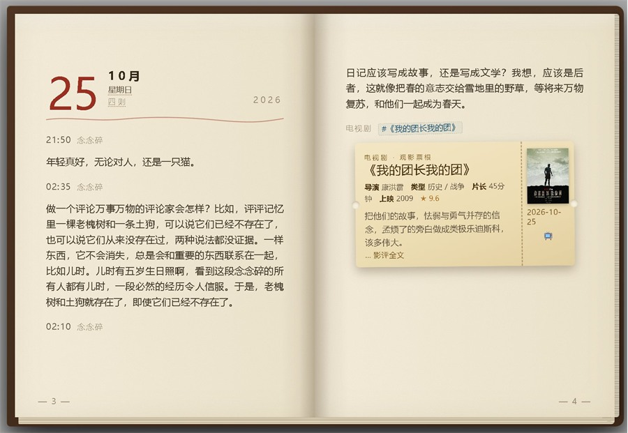</a>
      <br><b>日记本</b><br>
      <sub>一天能写多条，按月份装订成册</sub>
    </td>
    <td align="center" valign="top" width="50%">
      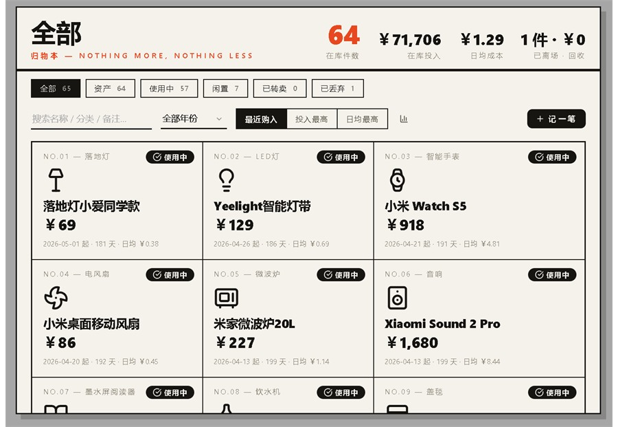
      <br><b>归物本</b><br>
      <sub>在库件数、日均成本与流转状态</sub>
    </td>
  </tr>
  <tr>
    <td align="center" valign="top" width="50%">
      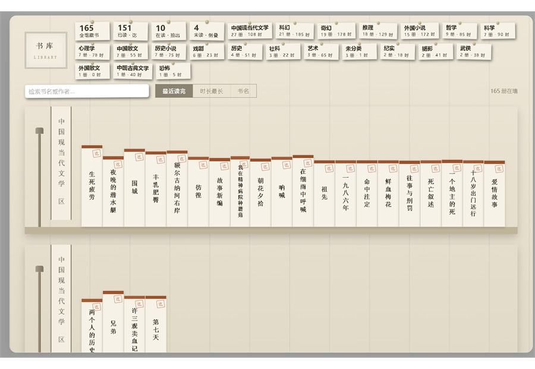
      <br><b>书库</b><br>
      <sub>书脊按时长和字数长，按题材装区</sub>
    </td>
    <td align="center" valign="top" width="50%">
      <a href="https://www.bilibili.com/video/BV15hxH6QEgM/">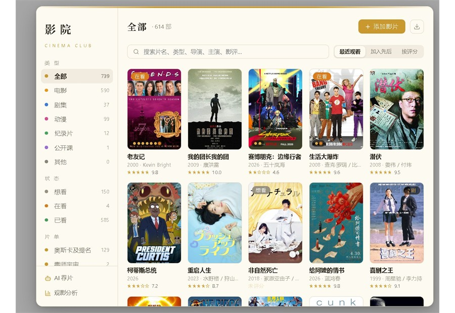</a>
      <br><b>影院</b><br>
      <sub>想看 / 在看 / 已看，海报自动补齐</sub>
    </td>
  </tr>
  <tr>
    <td align="center" valign="top" width="50%">
      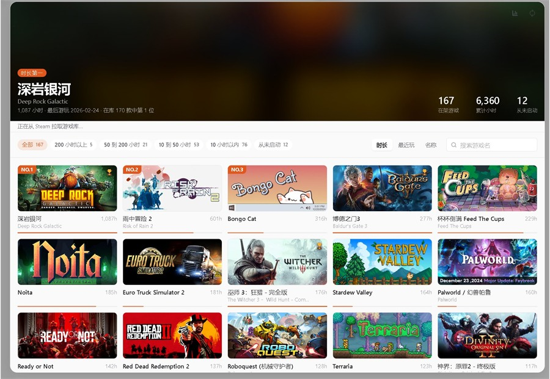
      <br><b>游戏库</b><br>
      <sub>从 Steam 拉时长，按游玩排行</sub>
    </td>
    <td align="center" valign="top" width="50%">
      <a href="https://www.bilibili.com/video/BV1pvxe6qEkf/">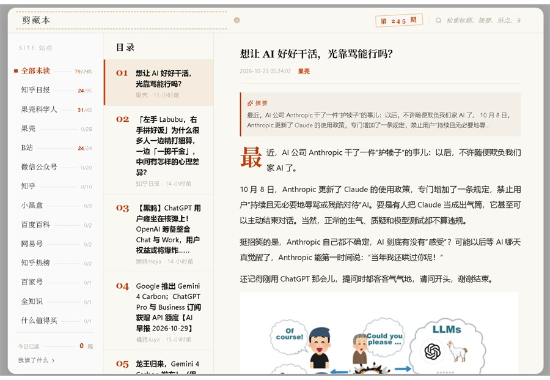</a>
      <br><b>剪藏本</b><br>
      <sub>网页剪藏 + 订阅源未读流</sub>
    </td>
  </tr>
  <tr>
    <td align="center" valign="top" width="50%">
      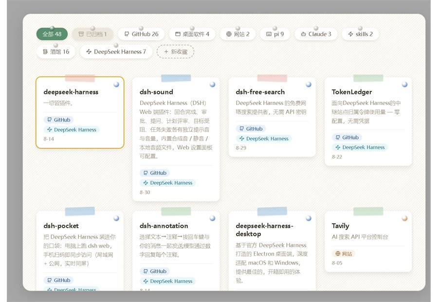
      <br><b>收藏本</b><br>
      <sub>链接按标签贴成便签，可归档可置顶</sub>
    </td>
    <td align="center" valign="top" width="50%">
      <a href="https://www.bilibili.com/video/BV1bR4s6dEjH">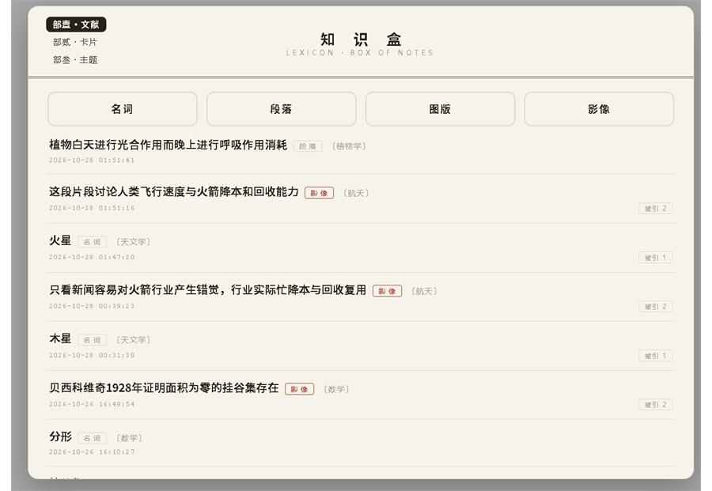</a>
      <br><b>知识盒</b><br>
      <sub>名词、段落、图版、影像四类文献</sub>
    </td>
  </tr>
  <tr>
    <td align="center" valign="top" width="50%">
      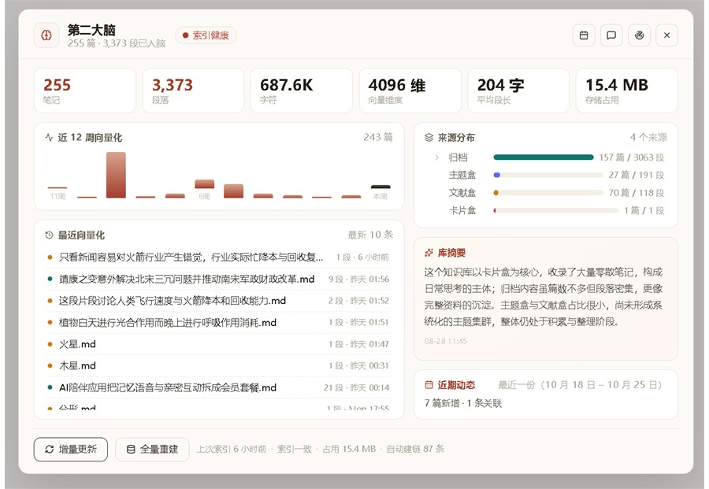
      <br><b>第二大脑</b><br>
      <sub>向量库规模、来源分布与索引健康</sub>
    </td>
    <td align="center" valign="top" width="50%">
      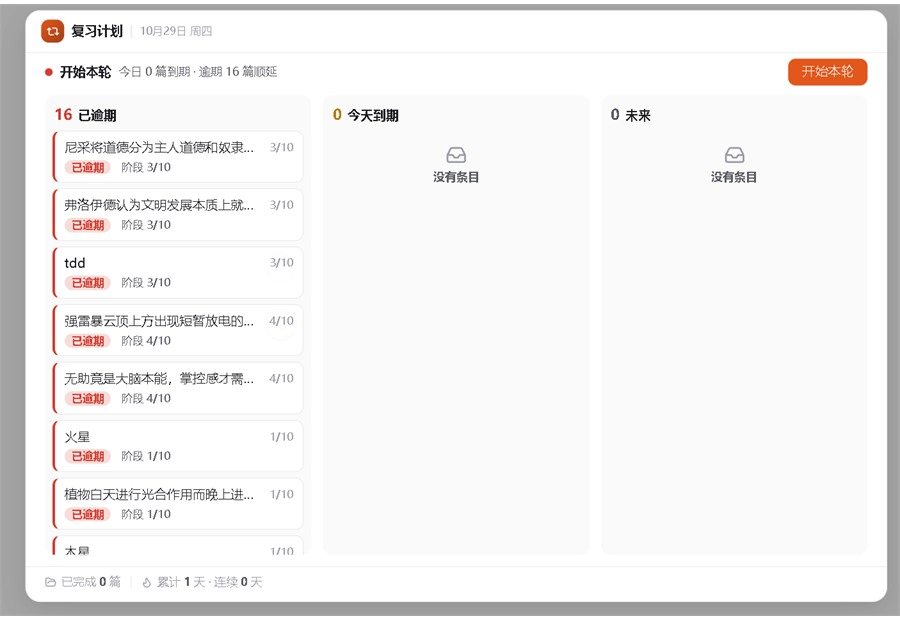
      <br><b>复习计划</b><br>
      <sub>逾期 / 今天 / 未来三栏排队</sub>
    </td>
  </tr>
  <tr>
    <td align="center" valign="top" width="50%">
      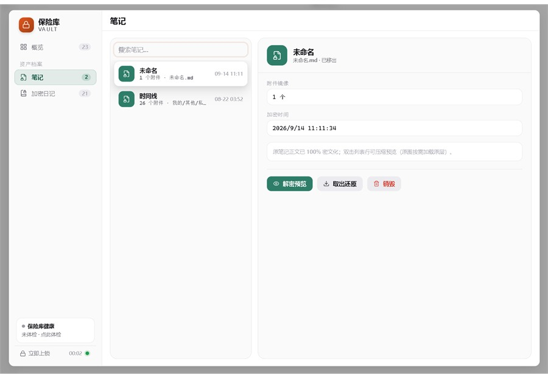
      <br><b>保险库</b><br>
      <sub>解密预览、取出还原、销毁</sub>
    </td>
    <td align="center" valign="top" width="50%">
      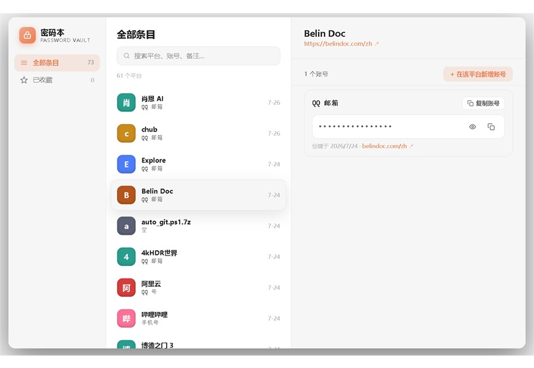
      <br><b>密码本</b><br>
      <sub>平台 / 账号 / 详情三栏</sub>
    </td>
  </tr>
  <tr>
    <td align="center" valign="top" width="50%">
      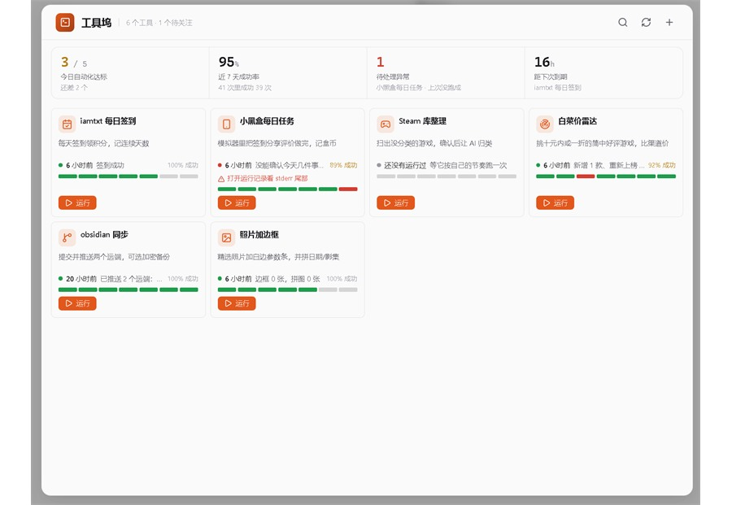
      <br><b>工具坞</b><br>
      <sub>外部工具的运行与观察</sub>
    </td>
    <td align="center" valign="top" width="50%">
      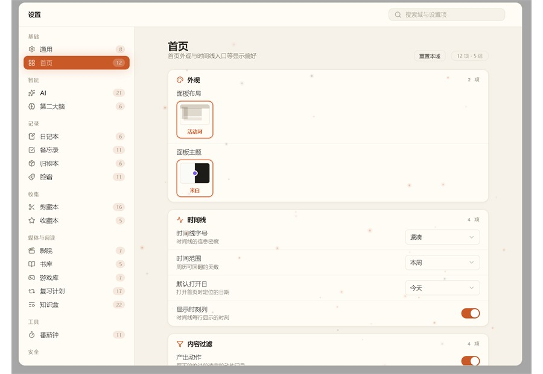
      <br><b>设置</b><br>
      <sub>全域设置聚在一处</sub>
    </td>
  </tr>
  <tr>
    <td align="center" valign="top" width="50%">
      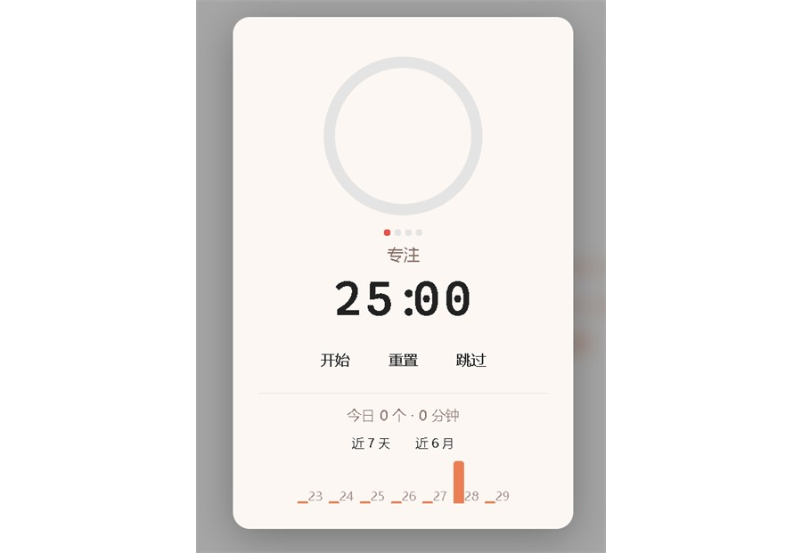
      <br><b>番茄钟</b><br>
      <sub>关掉窗口，计时照走</sub>
    </td>
    <td align="center" valign="top" width="50%">
      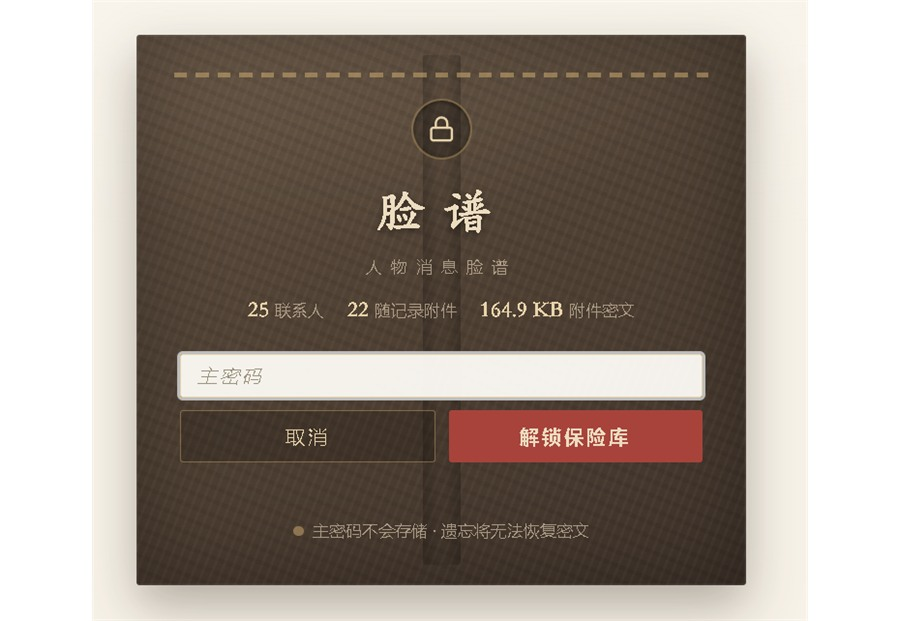
      <br><b>脸谱</b><br>
      <sub>人物档案与随记附件，同一把主密码</sub>
    </td>
  </tr>
</table>

## 安装

<sub>三分钟，不用装任何东西。</sub>

1. 到 [Releases](https://github.com/yeshimei/bz/releases) 下载最新的 `bz-<版本>.zip`
2. 解压到 vault 的 `.obsidian/plugins/` 下，得到一个 `bz/` 文件夹
3. 重启 Obsidian，在 <kbd>设置</kbd> → <kbd>第三方插件</kbd> 里启用 bz

## 生态

<sub>同一个作者，同一套本地优先。</sub>

**[bz reader](https://github.com/yeshimei/bz-reader)** —— 把 Obsidian 变成能读书的地方。桌面端与移动端、多格式（含 PDF）、多语言、AI 全书问答、双向链接，数据全部本地。

## 离线资源包

<sub>在线资源拉不动时，用这个。</sub>

皮肤、工具包、手册、影视索引下不动时，改用 `bz-offline-<版本>.zip`。解压出的 `downloads/` 整个放进插件目录，回插件点一次下载——本地校验通过就直接用，不联网。

```text
.obsidian/plugins/bz/
├── main.js
├── manifest.json
├── styles.css
└── downloads/
    ├── manifest.json
    ├── skins/
    └── tools/
```

## 开发

<sub>pnpm 一把梭。</sub>

```bash
pnpm install    # 装依赖
pnpm run dev    # 改代码自动构建
pnpm run build  # 出正式包
pnpm test       # 跑测试
```

想提交代码先看 [CONTRIBUTING.md](CONTRIBUTING.md)。架构约定在 [AGENTS.md](AGENTS.md)，术语表在 [CONTEXT.md](CONTEXT.md)。`issues/` 是作者内部的问题与设计记录，不是反馈入口。

## 支持作者

<p align="center">
  
</p>

<p align="center"><sub>微信扫一扫，请作者喝杯咖啡</sub></p>

插件的开发维护和教程视频都是一个人在做，免费、无广告。打赏会出现在 bz 所有插件的感谢名单里（插件内：<kbd>设置</kbd> → <kbd>通用</kbd> → <kbd>关于</kbd> → <kbd>支持作者</kbd>）。

**或者成为赞助人：[点击这里](https://wzyp.cn/shop/IFCEI5I3)**

---

<p align="center">
  <sub>MIT License · QQ 群 1130883117 · 用 Obsidian 打开你的第二大脑</sub>
</p>
