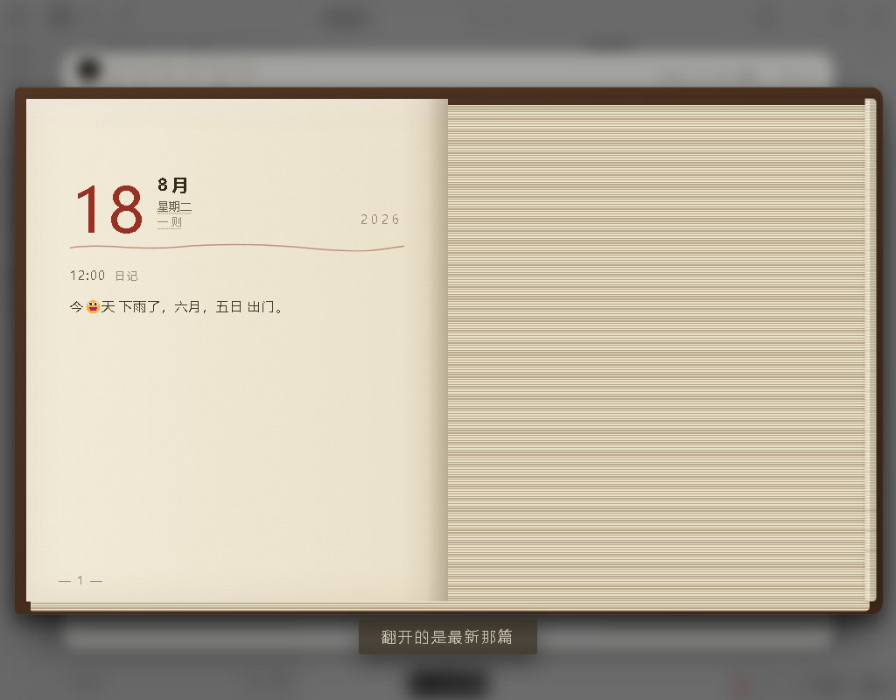
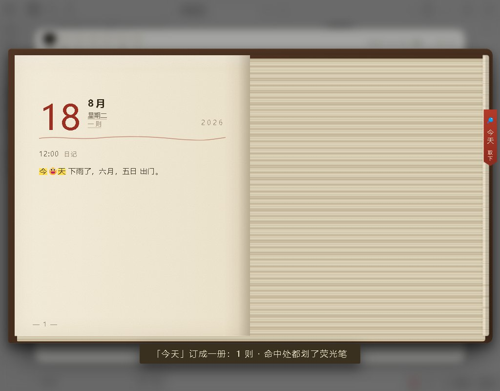

# 发版前置 review 三条采纳项 · 真机验证报告

分支：`fix/release-review-items`（worktree `D:\Obsidian\bz-wt-release-fixes`，从 master `044ffd93` 分叉，未合并）
日期：2026-11-20
形态：桌面 + 移动端，真实 Obsidian 进程 + 真实渲染 + 真截图（obsidian-visual-test 独立实例）

## 一、修了什么（用户点单）

发版前置 review 出 4 条，用户挑了 2 / 3 / 4 修，第 1 条判为流程要求（发版时重算统计）不动：

1. **第 2 条 · 高亮不吞字符** —— 放宽匹配会丢掉 emoji / 标点 / 空白，命中词的归一化字符在原文里未必连续。原实现按「首字符起点 → 末字符终点」整段切片，把中间被丢掉的字符一起标黄。改为逐字符按映射切回原文，只有原文紧邻才并成一个 mark，否则断开、中间原文照常输出。
2. **第 3 条 · 上锁退搜索册** —— 上锁分支无条件复位书签条却没清 `searchKw`，导致书页和高亮还是搜索册、书签「取下」入口却没了。改为上锁时 `searchKw = null`，一并退搜索册，状态与界面一致。
3. **第 4 条 · 路线图只展现自己的** —— bz 与 reader 共用一份在线配置，路线图条目原本混着 reader 的整套功能。给条目加 `plugin` 归属字段，bz 解析层只收自己的；缓存版本升 5 让旧缓存立刻作废重拉。

## 二、门禁

| 检查项 | 结果 |
|---|---|
| `node node_modules/typescript/bin/tsc --noEmit -p tsconfig.json` | ✅ EXIT=0 |
| `tests/diary/ui-book.test.ts`（含新增 3 条） | ✅ 153/153 通过 |
| `tests/core/bzr-data.test.ts`（含新增归属过滤 1 条） | ✅ 24/24 通过 |
| `node scripts/test-affected.mjs --since master` | ⚠️ 本次改动的两个测试文件全绿；全量套件另有 17 个失败，均在 master 基线同样存在（jsdom `resolveGradient` CSS 解析缺陷 + 书库/阅读报告渲染超时），与本次改动无关 |

第 2 条原测试是假阳性（夹具里别的「今天」满足了 marks 断言），已改成单条确定性断言；新增标点用例验证「六月，五日」搜「六月五日」只划两段、不吞逗号。

## 三、真机验证逐项（含截图）

测试素材：一篇日记，正文 `今😀天 下雨了，六月，五日 出门。`

### 1. 桌面 · 日记本全貌
打开正常，正文含 emoji 与标点，拟物书页清晰。

### 2. 桌面 · 搜索「今天」不吞 emoji（第 2 条核心）
点「找」输入「今天」订成册：书签挂「今天 / 取下」，Toast 报「「今天」订成一册：1 则 · 命中处都划了荧光笔」。正文里「今」「天」分别划黄，中间的 😀 完整留在外面、没被吞进高亮。eval 精确读取 `mark.bz-diary-hl-on` 的文本为 `["今","天"]`，两块、不含 emoji。

### 3. 移动端 · 日记本
390×844@3x：正文清晰无 dpr 模糊、无横向溢出，底部工具栏齐全。

### 4. 移动端 · 搜索册
移动端与桌面共用同一套高亮代码，布局正常。

### 第 3 / 4 条的验证口径
- 第 3 条（上锁退搜索册）真机触发需先配保险箱 + 解锁，成本高；改法是一行状态清理，已由单测「上锁时一并退出搜索册，书签取下入口与册子状态一致」精确覆盖（断言 `searchKw` 归 null、回全本、书签熄灭）。
- 第 4 条（路线图只展现自己的）依赖在线配置，真机拉的是远端尚未发布的数据；改法由单测「reader 的条目不进 bz，未标注的旧条目照收」精确覆盖。

## 四、未合并 / 未发版

按约定：改动只在 worktree，已构建部署到测试库 `E:/Obsidian/bz`，**未合并 master、未发版**。
