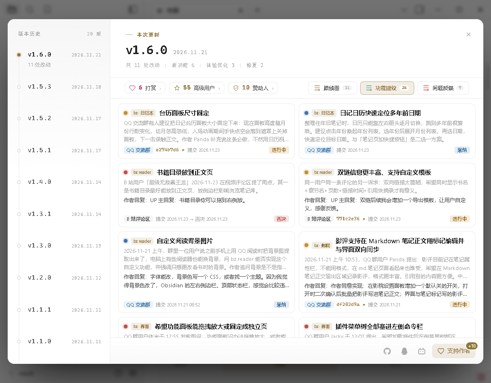
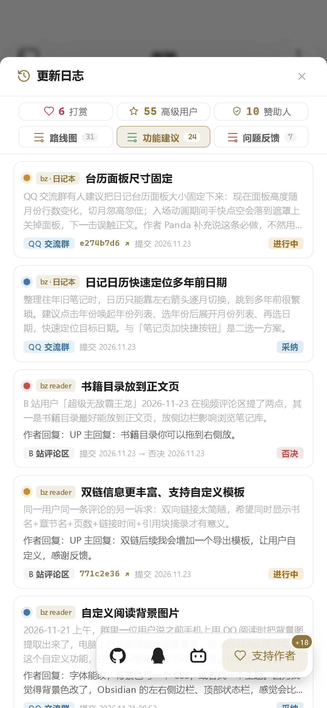

# 真机验证报告 · B 站评论区来源标注（2026-11-23）

> bz 主仓提交 `378a0413`（来源枚举 + 文案 + 样式），bz-reader 提交 `bf8f22d`（来源枚举 + 文案）。
> 测试机：桌面 1024×800、移动端 390×844@3x；真实 Obsidian 进程，独立库与调试端口。
> 需求：B 站视频评论区的反馈不能再标成「B 站私信」，要单独显示「B 站评论区」。
> 截图原图在 `docs/images/verify-bili-comment-source/`，随报告留存。

## 验证项与结论

### 1. 来源修正范围

- 描述：只把「超级无敌霸王龙」在视频评论区提的两条（书籍目录放正文页、双链信息更丰富）从 `bili-dm` 改成新增的 `bili-comment`；其余 4 条真正的 B 站私信保持 `bili-dm` 不变。
- 结论：✅ 通过。

### 2. 桌面端来源徽标

- 描述：设置页 → 更新日志 → 功能建议，两条反馈的来源徽标都显示「B 站评论区」（粉色），与同组「QQ 交流群」等徽标区分明显；其余 B 站私信条目仍显示「B 站私信」。
- 结论：✅ 通过。
- 截图证据：

### 3. 移动端来源徽标

- 描述：390×844@3x 下同一列表，两条反馈的「B 站评论区」徽标完整显示，无截断、无横向溢出。
- 结论：✅ 通过。
- 截图证据：

## 门禁

- bz-reader：`tsc --noEmit` 通过；`vitest` 375 文件 / 4262 测试全绿（新增解析与来源标签 2 项）；`esbuild once` 通过
- bz 主仓：`tsc --noEmit` 通过；`vitest` 全量 10450 通过 / 2 失败——失败项 `sp-contract-lock`（域 global 可见项数基准 7→8）在改动前的 master 上同样失败，与本次无关；river-cache / mood-gating / enhance 全量并发时的偶发失败在工作树单独重跑全绿
- 多语言：更新日志框架文案本就只有中英两版，两边都已补；其余七包不涉及
- 禁悬停气泡：`check-tooltip-attrs` 通过（bz-reader）
- 临时脚本均放在仓库外的 `%TEMP%`，未落仓库根目录
