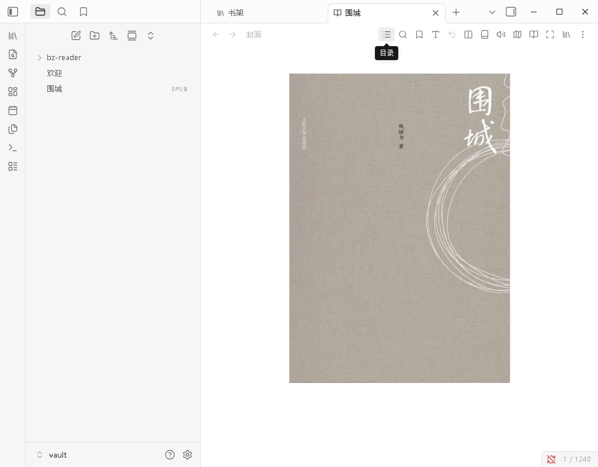
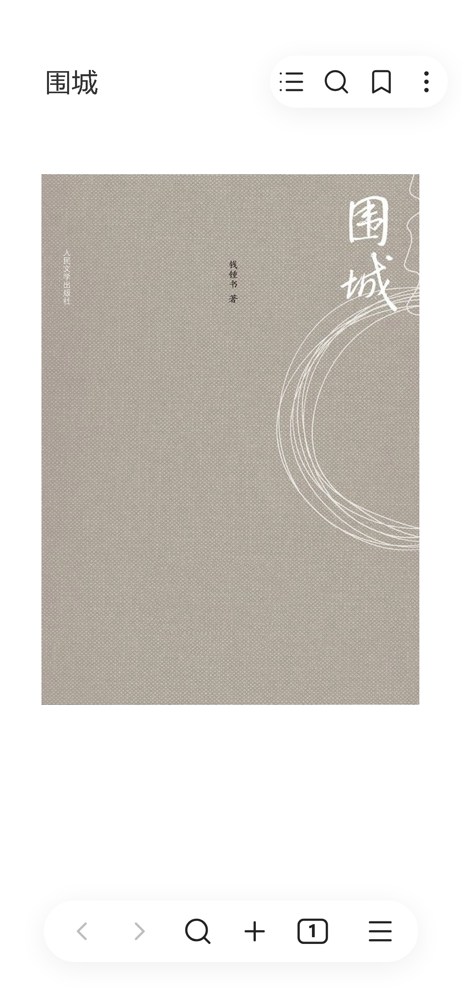
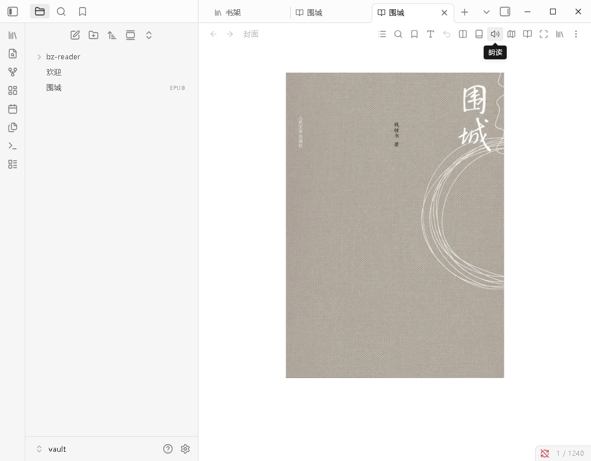

# 真机验证报告：阅读器头栏图标悬停气泡（fb-20261124-qqc-01）

> QQ 频道用户「天道酬勤」建议给阅读器工具栏按钮加气泡提示（如 Obsidian 原功能一样）。
> 作者拍板：做，但只给选定的一批按钮加（不做成全局 UI 都有）；气泡文案去掉快捷键；
> 出现时机用 Obsidian 默认。改动在 bz-reader `fix/header-tooltip` worktree 完成。

## 验证环境

- 插件：bz-reader 1.6.0（worktree `fix/header-tooltip` 的 `dist/pro` 三件套，部署到独立 obs-test 实例）
- 真机：真实 Obsidian 进程，桌面 1024×800 + 移动端 390×844@3x，主题 light
- 测试书：围城.epub
- 门禁：tsc 通过；vitest 除 2 个 master 预存的 `revoked.test.ts` 签名失败外全绿（4316 通过）；esbuild 通过；`check-tooltip-attrs.mjs` 通过；`i18n-placeholders.mjs` 通过

## 逐项验证

**1. 桌面端：悬停「目录」图标弹出气泡，文案不带键位。**

鼠标悬停阅读器头栏「目录」图标，其下方弹出黑色气泡「目录」——原本标签是「目录（s）」，按作者要求去掉了 `（s）` 键位提示。气泡样式与 QQ 频道截图里 Obsidian 原生的「更多选项」气泡一致。证明气泡已在头栏按钮上生效，且文案去键位正确。

**2. 移动端：工具栏布局正常，不因气泡改动报错或错位。**

移动端阅读器正常打开，工具栏 3 颗按钮（目录 / 搜索 / 书签）+ ⋮ 布局完好，未见气泡（手机无悬停能力，符合预期），无报错、无横向溢出。证明挂气泡的改动不影响移动端界面。

**3. 桌面端：悬停「朗读」图标同样弹出去键位的气泡。**

悬停「朗读」图标，弹出气泡「朗读」——原标签「朗读（r）」去掉了 `（r）`。证明白名单内多颗按钮都带气泡、文案去键位逻辑对所有按钮一致生效，而非只对某一颗。

## 结论

- 气泡只在阅读器头栏图标按钮上挂（白名单），设置页 / 侧栏 / 弹窗等全局 UI 一律不挂——符合作者「选择性」要求。
- 气泡文案去掉单字母键位（（s）/ (r) 等），保留「复制链接（页 / 视图 / 嵌入 / 标注）」这类说明性括号。
- 出现时机交给 Obsidian 默认，未自定义延迟或位置。
- 门禁脚本对 `setTooltip` 加了唯一文件白名单（src/view/header-tooltip.ts），其余 UI 想加气泡仍会被拦——从机制上守住「不做成全局」。
- 桌面 + 移动端均验证通过，无回归。改动待合并 master；未发版，反馈状态记「进行中」。
