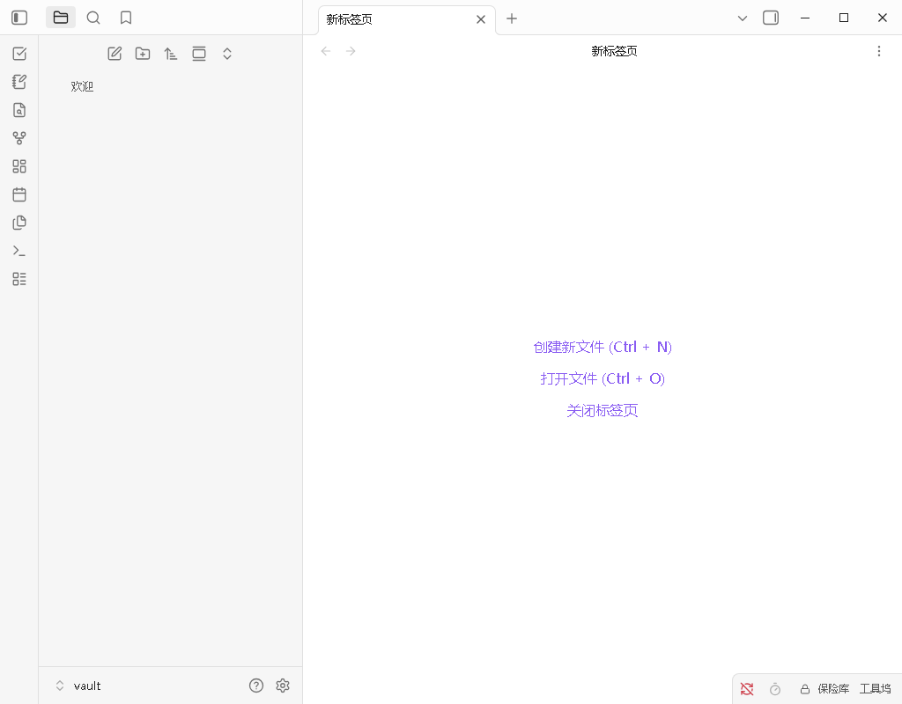
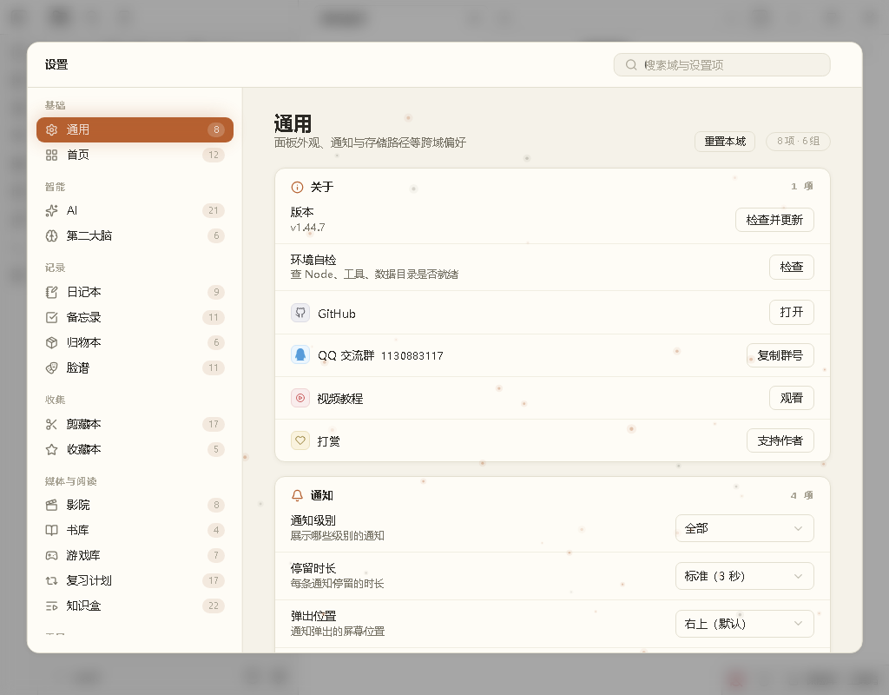
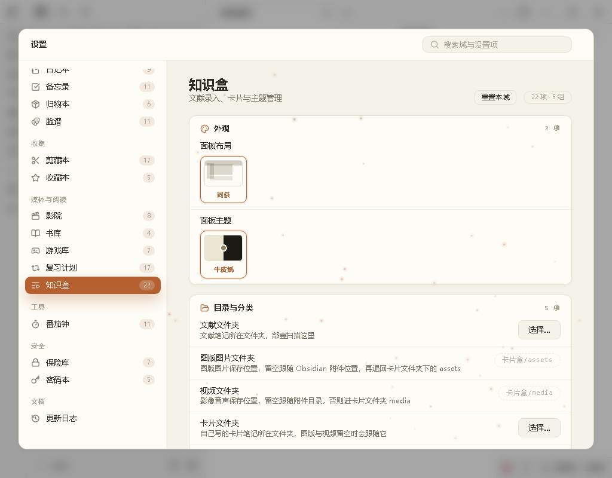
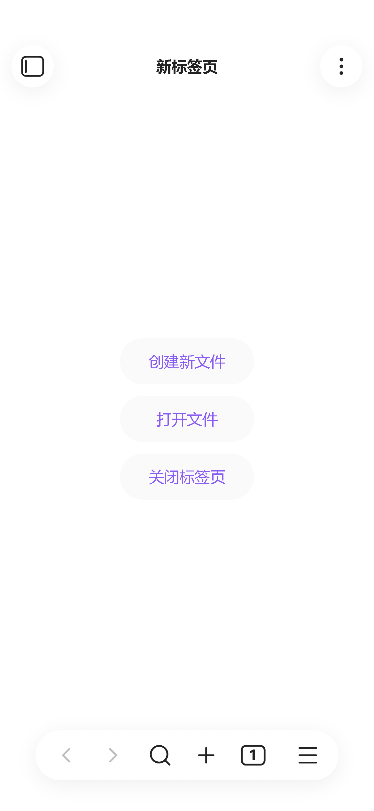
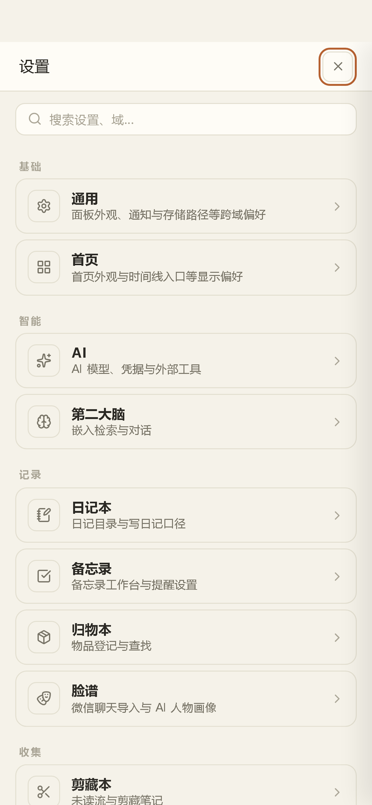
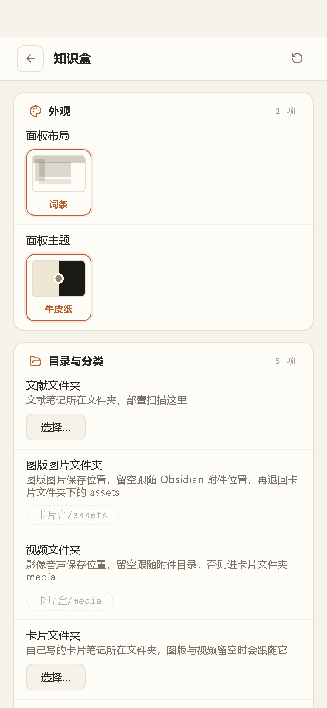

# 真机验证 · issue 571 知识盒视频交付目录跟随

日期：2026-11-24（Asia/Shanghai） · 分支：`fix/knowledge-video-dir-follow`（worktree `D:\Obsidian\bz-wt-video-dir`）
关联：issue 571 / ADR-0300

## 环境

| 项 | 值 |
|---|---|
| 构建落点 | `E:/Obsidian/bz/.obsidian/plugins/bz`（测试库，未落主库与仓库根） |
| 构建方式 | `BZ_VAULT_DIR="E:/Obsidian/bz/.obsidian/plugins/bz" node esbuild.config.mjs once` |
| main.js | 23,907,242 字节，2026-11-24 20:09:22（本次构建） |
| 实例 | `bz-v571`，独立库 `D:\obs-test-runs\runs\bz-v571\vault`，端口 58562，插件 v1.44.7 已加载 |
| 视口 | 桌面 1024×800@1；移动 390×844@3（1170×2532） |
| 门禁 | `test-affected --since master` 706 文件 / 10453 用例全绿；`tsc --noEmit` 干净；工具包 `node --test` 89 项全绿 |

## 桌面端过程

图 1：独立实例的空库正常打开，插件已加载——验证环境干净、不是主库残留态。

图 2：`bz-settings-panel-open` 打开全域设置面板，左侧「知识盒 22」——项数已从 21 更新为 22（+视频文件夹行、+恢复卡片文件夹行），与契约锁基准一致。

图 3：知识盒「目录与分类 5 项」里，图版图片文件夹显示回落 `卡片盒/assets`、**视频文件夹显示回落 `卡片盒/media`**、卡片文件夹行已恢复显示（右侧「选择…」按钮在位）——三行同屏证明图版与视频都跟随卡片盒，末跳分别是 assets/ 与 media/，没有混在一起。

## 移动端过程

图 4：`mobile on` 后 390×844@3 手机布局，底部导航与安全区正常。

图 5：移动端重新打开设置面板，卡片式域列表、关闭按钮可点——切换布局重建工作区后入口仍可达。

图 6：移动端知识盒「目录与分类 5 项」完整显示图版 `卡片盒/assets`、视频 `卡片盒/media`、卡片文件夹「选择…」按钮；长文案自动折行、无横向溢出、回落 chip 未被底部裁切。

## 结论

- 设置面板确实给出了「视频文件夹」这一行，且空值时把算出的落点直接显示出来——不再让用户猜、也不再落到写死的机器路径。
- 图版与视频两行都跟随卡片盒（分别 `assets/` 与 `media/`），卡片文件夹行恢复后用户能直接设置它。
- 桌面与移动闭环都走通，截图逐张对照无异常。

## 未覆盖（如实标注）

- **完整视频生成链路未在真机跑到底**：本轮改动的核心是把 `outputDir` 从「留空交给工具写死默认值」改为「插件算出库内路径恒下发」，该下发逻辑由 `tests/knowledge/processor.test.ts`（空设置下 `options.outputDir` 恒为 `vault/卡片盒/media`、显式绝对路径原样下发）与工具包 89 项测试覆盖；真机直接跑影像任务还依赖外部 bili-dl 包与 Python 转写环境（此前同一环境下复现过 torchaudio / kaldi-native-fbank 缺失导致的空文本），本轮未把它列为通过。
- **存量旧笔记未迁移**：按 ADR-0300 决策 5，已有绝对路径死链不回改，只保证新生成的正确。
