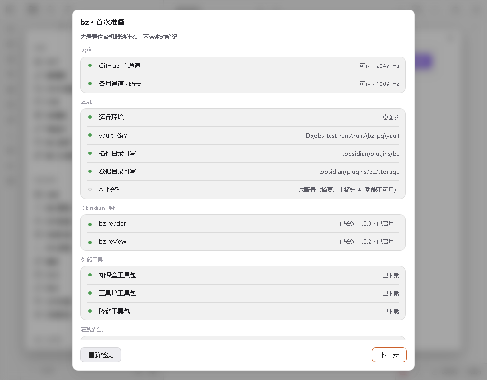
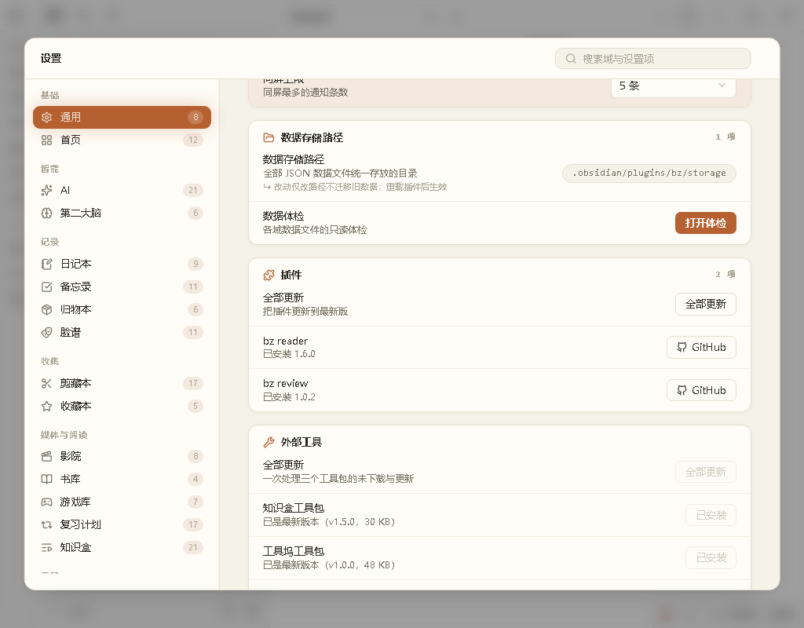

# 配套插件组（bz reader + bz review）与码号探针 · 真机验证

日期：2026-11-22
分支：`feat/plugin-group`（`82a7fcb5`，未合并）
验证实例：`bz-pg`（已 `rm`）

## 一、这次做了什么

把 bz 从「只管一个 bz reader」改成「管一组配套插件」，第一组是 **bz reader + bz review**。

| 层 | 改动 |
|---|---|
| 安装器 | `core/reader-install` 参数化：每个插件一份 `PluginSpec`（id / 名字 / 两个仓库地址），读状态、拉 Release、写三件套、启用、自动更新全部同构 |
| 设置面板 | 「插件」组从一行变两行，各自独立的版本号与按钮状态；「全部更新」串行跑，reader 在前 |
| 引导页 | 检测屏两行、下载队列两项；review 依赖 reader，顺序固定 |
| 探针 | 快照带 `readerLicenseId` 与 review 的五个字段（状态 / 档位 / 版本 / 条目数 / 距今天数）+ `reviewLicenseId` |
| 码号解析 | `reader-tier` 认 `BZR*` 与 `BZP*` 两种前缀；只取 `payload.id`，昵称、订单号、码原文一律不取 |
| 披露 | bz README「数据」节写明会带上档位与码号，并列出不会上传的东西 |

**bz-reader 与 bz-review 两个仓库一行代码都没改。** 探针全部由 bz 侧读文件完成。

## 二、真机验证

实例：全新库 + 真 Obsidian 进程，装 bz 1.44.6（本次构建）+ bz reader 1.6.0 + bz review 1.0.2，
两个插件都用**真实激活码**（reader `BZR-AF-2026-0176`、review `REV-2026-0001`）。

### 1. 引导页：两个插件各一行，状态各自独立



- 同一个「Obsidian 插件」组下两行：`bz reader` 已安装 1.6.0 · 已启用、`bz review` 已安装 1.0.2 · 已启用；
- 两行的绿点、版本号、安装/更新按钮互不影响；
- 点「重新检测」会重新读盘，第一次截图里那两行还是插件装好之前的快照（显示「未安装」），刷新后正确。

### 2. 设置面板：插件组 2 项，各带 GitHub + 更新按钮



- 组标题右侧计数是「2 项」；
- `bz reader` 与 `bz review` 各一行，已是新版时只留 GitHub（不摆灰按钮），有新版才露「更新」；
- 两行的判定互不串台（单测里钉过：review 有新版只影响自己那行）。

### 3. 探针在真机上读到了码号

在实例里直接读 bz 进程看到的两个码：

```
installId   6174d455-d867-4b6f-89dc-25aec180946c   ← initUsage 跑过了
reader      BZR2 → BZR-AF-2026-0176
review      BZP2 → REV-2026-0001
```

注意 review 的码号格式是 `REV-2026-0001`（不是 `BZR-*`），解析层已经兼容。

## 三、卡住的地方：Appwrite 写入配额已耗尽

验证「上报到服务器」这一步时发现：**Appwrite 现在一条都写不进去**。

```
POST /databases/bz_usage/collections/installs/documents
→ 402 {"message":"Database writes limit for the current billing cycle has been exceeded.
        Please upgrade to a higher plan or update your budget cap."}
```

**这不是本次改动引入的**，是 bz 现有的统计链路把额度用完了。算一下就明白：

| 项 | 数 |
|---|---|
| 装了 bz 的设备 | 403 台 |
| 心跳间隔 | 2 分钟 → 720 次/天/台 |
| 每次心跳的写请求 | 4 次（installs 先 POST 撞 409 再 PATCH；presence 同样） |
| 每天 | **约 116 万次** |
| 每月 | **约 3500 万次** |

免费套餐的写入额度差着两个数量级，所以必然几天就爆。

### 连带的两个后果

1. **「1.6.0 零台」可能是假象。** 1.6.0 是 11-21 11:41 发的，而库里最后一台活跃设备停在 0.9 天前（11-21 早上）。如果配额在那之后耗尽，这几天所有设备的上报都没写进去——不是没人升级，是数据没到。
2. **探针上线后也会静默失败。** 代码里 `api()` 失败只打一行 `console.warn`，不打扰用户，所以从界面完全看不出来。

### 顺带发现

`presence` 集合**只有写入、没有任何读取方**（`src` 里搜不到读它的代码）。每 2 分钟写一次纯属白烧额度。

## 四、改造（2026-11-22 当天已做）

三条全做了，提交在 `f7464306`：

1. **整条心跳删掉**（不是降频）：`PingPayload` / `sendPing` / 2 分钟定时器全部移除；
2. **presence 停写**：它的读取方为零，本来就不该写；
3. **upsert 记住已存在的文档**：第二次起直接 PATCH，不再每次 POST 撞 409。

改完的写入量：

| | 改前 | 改后 |
|---|---|---|
| 每台每天 | 2884 次 | 约 2 次 |
| 403 台每天 | 116 万 | 约 800 |
| 每月 | 3480 万 | 约 2.4 万 |

**降约 1440 倍。**

### 顺手修了一个会让探针彻底失效的 bug

`buildDailyPayload` 只拷贝固定字段，`reader` / `review` / `guideDone` / `updateAuto` 这几项
一直是**跟着心跳**发出去的（心跳把 `meta` 整份展开）。心跳一删，码号就永远到不了服务端——
日汇总这条唯一路径上根本没有这几个字段。

现在 `buildDailyPayload` 显式带上它们，并有单测钉住（`usage-payload.test.ts` 的
「配套插件快照跟着日汇总走」）。

### 新增的跨重启节流

日汇总每次都要重发「今天」（水位只认已经过完的日子），而上传计时器是进程内的。
用户反复重载插件就会反复发同一份。现在用账本里的 `lastAttemptAt` 挡住一小时内的重复，
一天重启十次也只发一次。

## 五、还需要你在 Appwrite 控制台确认一件事

新字段能不能写进去，我没法验证（被 402 拦在写入之前）。请打开 **Databases → bz_usage → installs → Attributes**，确认有没有这些：

```
readerLicenseId   string
reviewState       string
reviewTier        string
reviewVersion     string
reviewItems       integer
reviewDaysSince   integer
reviewLicenseId   string
```

没有的话要加（都设成 optional）。Appwrite 的集合是固定 schema，没有的属性写进去会整条失败。

## 六、测试与门禁

| 项 | 结果 |
|---|---|
| `tsc --noEmit` | 0 |
| `vitest run`（全量） | 704 文件 / 10399 用例：2 个失败，均为 master 上已有的基线问题（`sp-contract-lock` 的 global 域 7→8、`river-cache` 时序），与本改动无关 |
| 新增/改动的测试 | `plugin-resources` 15、`review-usage` 13、`reader-tier` 23，全过 |
| `esbuild once` | 通过，产物已落测试库 `E:/Obsidian/bz review`（main.js 23.8 MB / 8:49:52） |

## 七、现在的状态

- 代码在 `feat/plugin-group`，三个提交：`82a7fcb5`（配套插件组 + 码号探针）、
  `c09388fb`（本报告）、`f7464306`（去心跳）；
- **没有合并到 master**；
- 测试库已是最新构建（main.js 9:06:22）；
- 真机实例已清理。

**剩下两件事等你**：
1. Appwrite 控制台确认那七个字段（第五节）；
2. 配额恢复后合并、发版，然后在本地用真码跑一遍看数据到没到。
