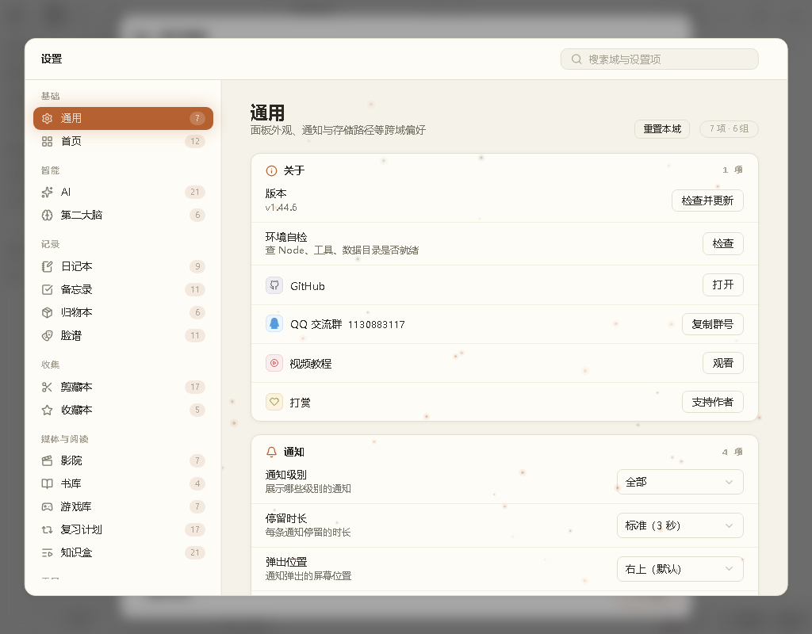
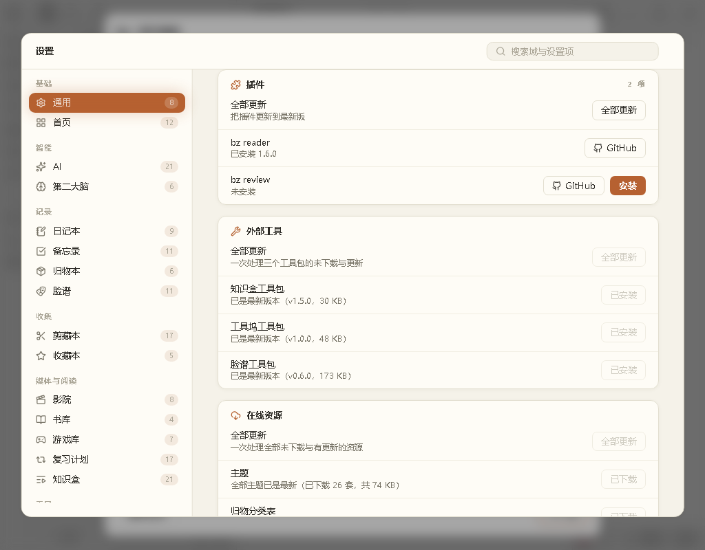
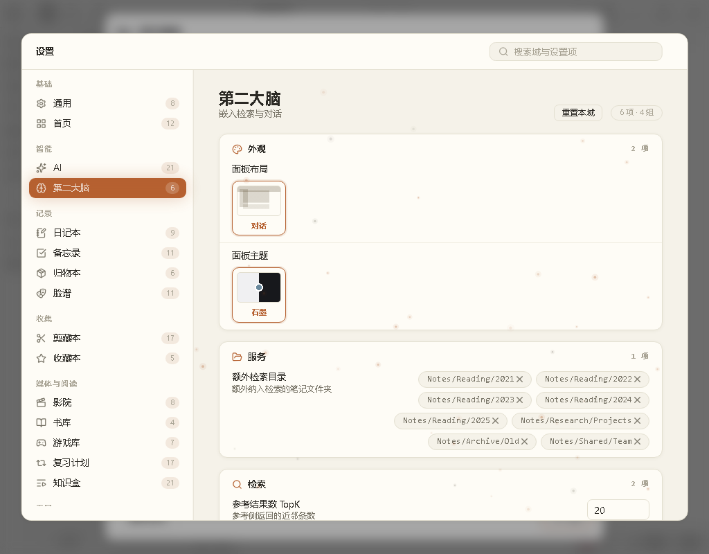
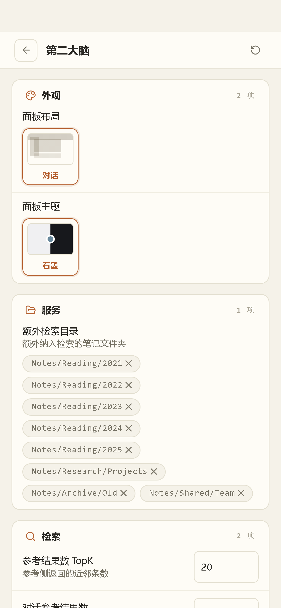
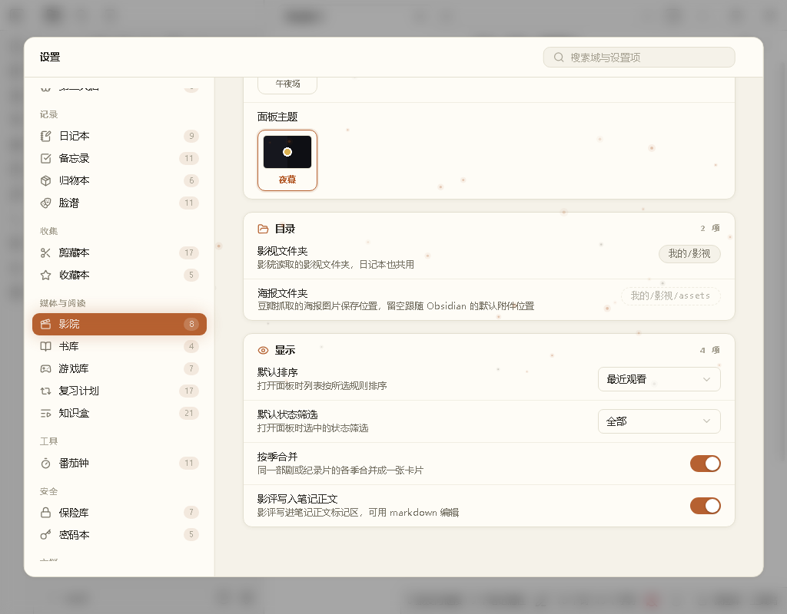
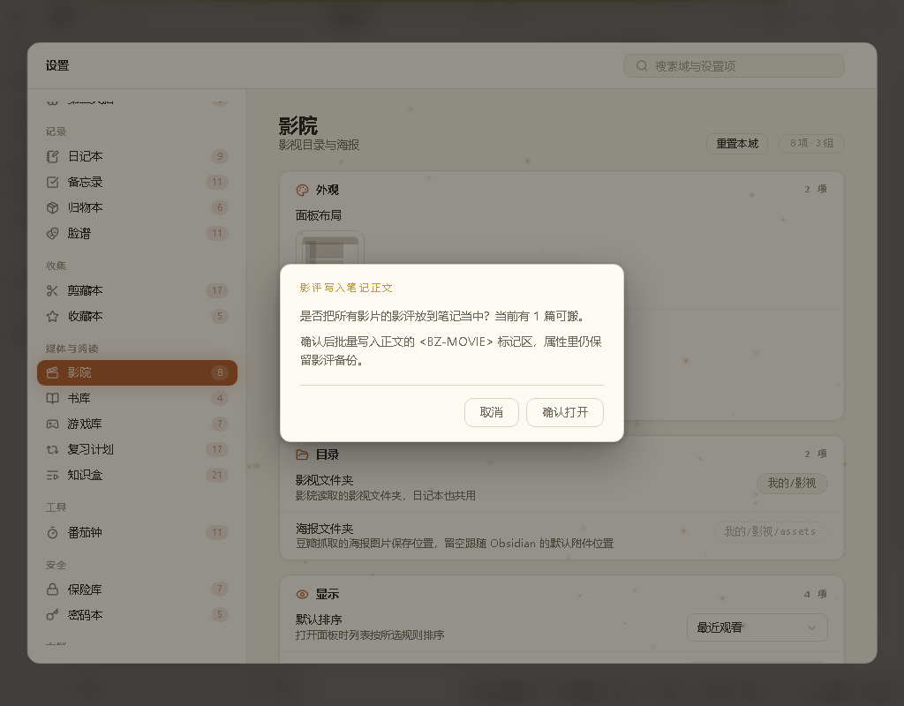
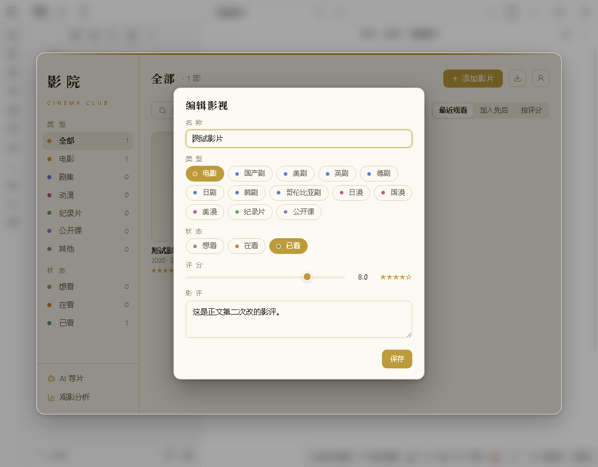
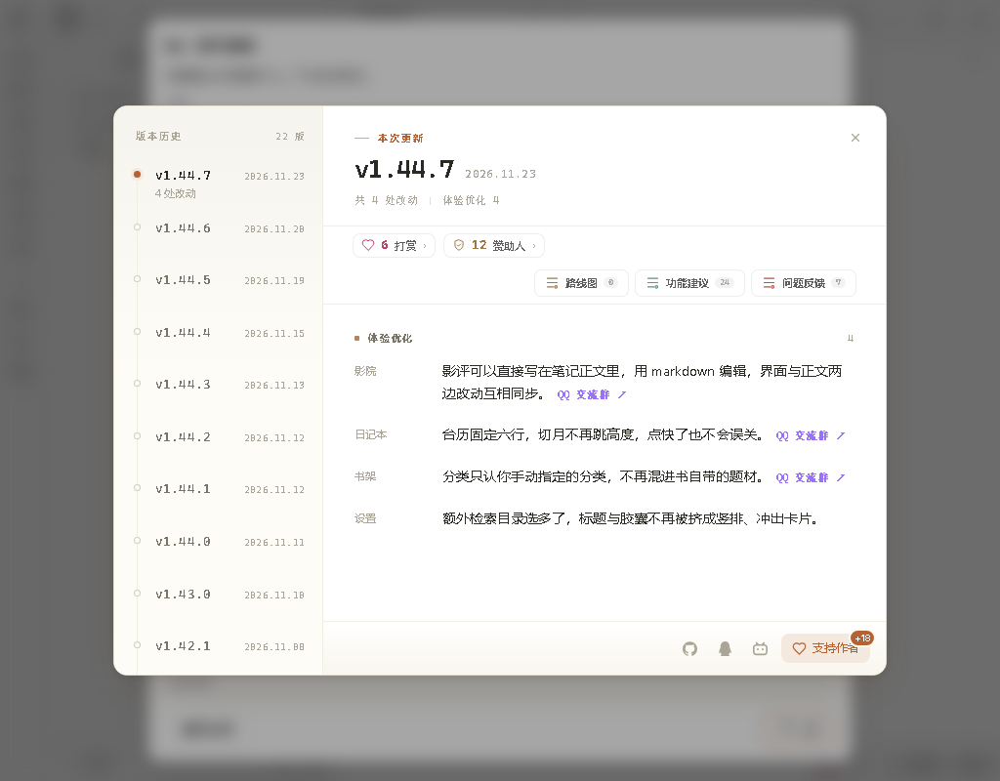

# v1.44.7 版本区间真机验证

- 日期：2026-11-23
- 范围：`v1.44.6..HEAD`（41 个提交 + 工作区修补），基线 tag `v1.44.6`
- 环境：独立 obs-test 实例 `bz-verify`（`D:/obs-test-runs/runs/bz-verify/vault`），桌面 1024×800 / 移动端 390×844@3x
- 插件：先用 `v1.44.6` 的 Release 安装包（码云通道）装起，覆盖成本次构建的 `main.js` / `manifest.json` / `styles.css`
- 构建：`BZ_VAULT_DIR=<测试库> node esbuild.config.mjs`（日常构建，不进主库）

## 一、本版改了什么（按用户能摸到归并）

| 编号 | 改动 | 怎么验 | 期望 |
|---|---|---|---|
| V1 | 设置「插件」组两个插件各一行（bz reader / bz review），一键装/更新 | 设置 → 通用 → 插件组 | 两行都在，未装的显「安装」 |
| V2 | 额外检索目录选多了不再挤成竖排 | 造 8 个目录，桌面 + 移动看该行 | 标题横排，胶囊折行不溢出 |
| V3 | 影院「影评写入笔记正文」开关（批量迁入 + 双向同步） | 造一部影片 → 开开关 → 核对正文标记 → 正文改 → 看属性 | 正文出现 `<BZ-MOVIE>`，两边互相同步 |
| V4 | 台历固定六行、入场期误点不关 | 日记 → 跳日子 | 网格恒 6 行，切月不跳高度 |
| V5 | 更新日志统计固定值 + 来源角标写真实来源 | 弹更新日志 | 打赏 6 / 赞助人 12；三条目尾「QQ 交流群 ↗」 |
| V6 | 书架分类只认手动 shelf | 纯数据映射，由 `tests/bookshelf` 覆盖 | —— |
| V7 | 升级不丢数据 | 旧版改设置 → 覆盖三件套 → 重启 | 版本变了，设置值原样保留 |

## 二、逐项结果

### V7 升级不丢数据 —— 通过

旧版 1.44.6 里把影院主题改成 `gazette`、额外检索目录写成 8 条，覆盖 1.44.7 三件套并重启：

- 版本：`1.44.6` → `1.44.7`
- `cinemaStyle` 仍是 `gazette`，8 条目录仍在（设置面板渲染见 V2 截图）
- 升级前基线：



### V1 插件组两行 —— 通过



bz reader 已装 1.6.0、bz review 未装（「安装」可点），组首「全部更新」可点。

### V2 检索目录折行 —— 通过（桌面 + 移动）

桌面：8 个胶囊在右侧折成 4 行，标题列保住了宽度，没有冲出卡片。



移动端：名称/说明独占首行，胶囊落到第二行、从左排，一行两枚。



### V3 影评写入笔记正文 —— 通过

开关默认关；打开时先弹影院风格确认框，篇数实时统计（当前 1 篇可搬）。





确认后正文出现标记块（frontmatter 之后、正文之前），属性「影评」保留：

```text
<BZ-MOVIE>
这是一条测试影评。
</BZ-MOVIE>

正文里的一段话，用来确认标记插在它上面。
```

双向同步两条都走通：

- 正文改 → 属性：正文写成「这是正文第二次改的影评。」后，`metadataCache` 里的「影评」变成同一句
- 界面改 → 正文：编辑表单里改成「界面改的影评，验正文同步。」保存后，正文标记块同步成同一句

影片详情与编辑表单：




### V4 台历固定六行 —— 通过

2026 年 1 月只占 5 行，网格补到 6 行；切月不再改面板高度。


### V5 更新日志 —— 通过

统计卡按名单固定为 6 打赏 / 12 赞助人；三个带来源的条目尾部是「QQ 交流群 ↗」，设置那条无角标。



### V6 书架分类口径 —— 未覆盖（原因）

测试库是空库，没有 EPUB 书籍，真机走不到书架墙的分类渲染；口径是纯数据映射（`epubCategory` 不再回退 `meta.subjects`），由 `tests/bookshelf/data.test.ts` 与 `tests/reading-report/epub-notes.test.ts` 覆盖。

## 三、附带观察到的事

1. **`<BZ-MOVIE>` 在 Obsidian 正文里不可见**：它不是合法 HTML 标签，实时预览/阅读视图会把边界吞掉，用户只看到影评文字。编辑文字没问题，但看不见边界、手改标记容易改坏——已在本版加了「半截标记不清空属性」的保护（review #1）。
2. **外部脚本改文件会造成混合换行**：验证过程中用 python 直接写文件（LF）叠加 Obsidian 的 CRLF，正文接缝出现多余空行；改用插件 API 写入的干净文件接缝只有一个空行。不是插件路径的问题。
3. **首次准备页会挡住影院面板**：空库首次启动弹引导，点「下一步」进入安装流程；验证时把 `setupDone` 置真跳过。属于预期行为，不是缺陷。

## 四、结论

V1、V2、V3、V4、V5、V7 通过；V6 未覆盖（空库无书，测试覆盖）。没有 P0/P1 未过项，可以进入打包与打 tag。
