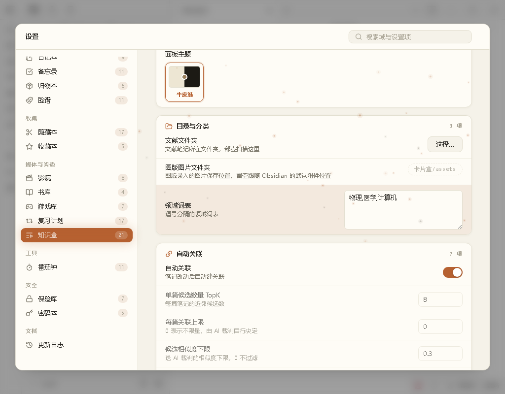
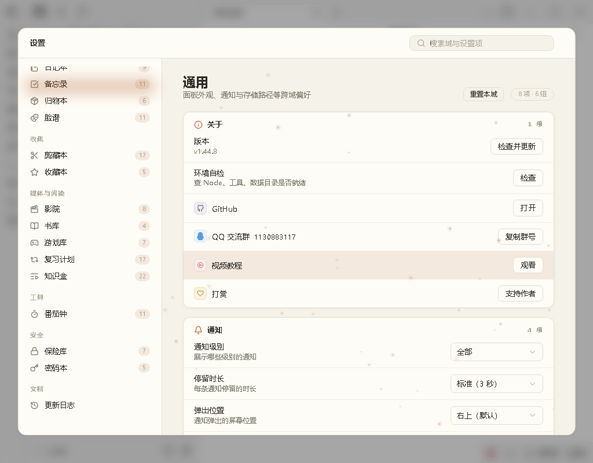
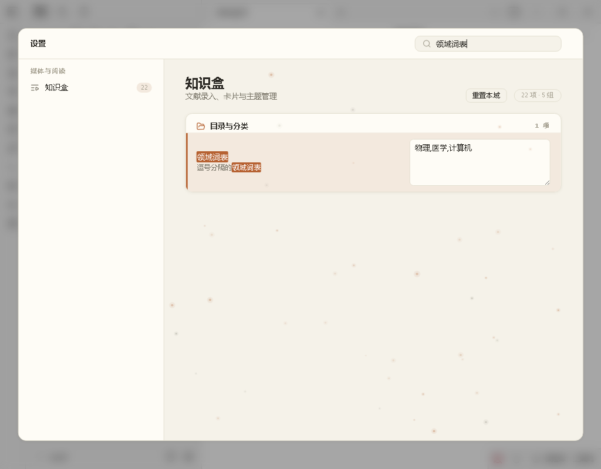
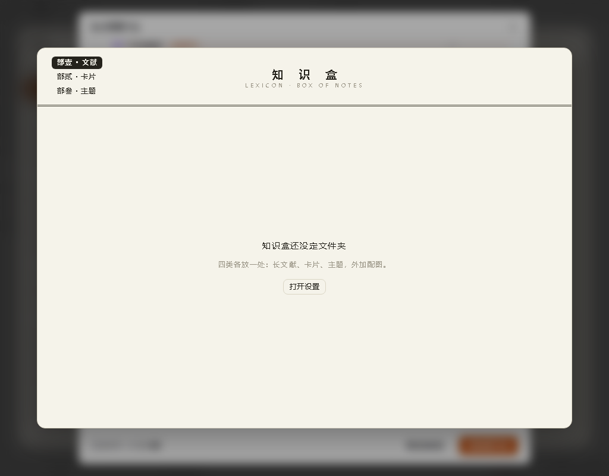
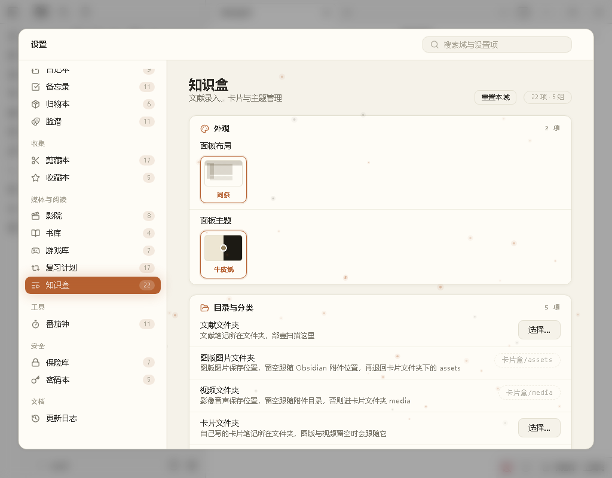
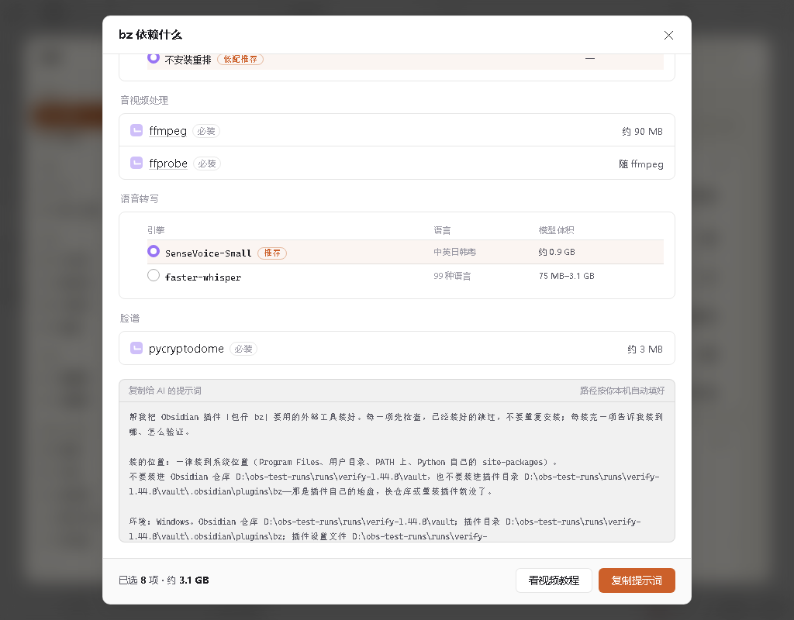
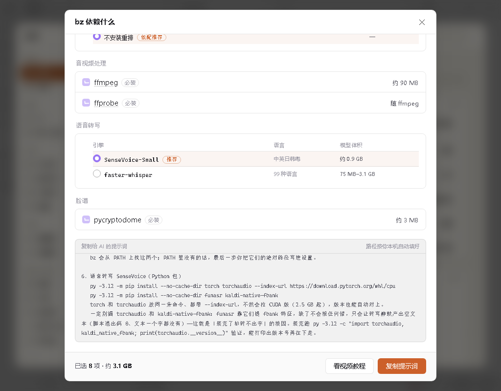

# v1.44.8 发布前真机验证

日期：2026-11-24　基线：`v1.44.7`（上个已发布版本）　区间：`v1.44.7` → 当前工作区，12 个提交

构建：2026-11-24 20:39，`node esbuild.config.mjs once`（`BZ_VAULT_DIR` 指向仓库外临时目录），main.js 24,016,906 字节；桌面 1024×800 / 移动 390×844@3x

## 一、本版改了什么

- 知识盒的视频目录跟着卡片文件夹走，设置里能看到算出来的实际落点（issue 571 / ADR-0300）
- 语音转写的安装提示补齐 `torchaudio` 与 `kaldi-native-fbank`
- 转写产出空文本时按失败处理，并在原因里写清缺哪个依赖
- 另有文档与 note 定稿提交

## 二、验证环境

| 项 | 值 |
|---|---|
| Obsidian | obs-test 独立实例（桌面版） |
| 实例 | `verify-1.44.8`，初始装 `v1.44.7` 三件套 |
| 测试素材 | 全新空库；设置改动取「知识盒 · 领域词表」 |
| 构建 | `BZ_VAULT_DIR=<临时目录> node esbuild.config.mjs once`，manifest `1.44.8` |

## 三、逐项验证

### V1 升级不丢数据（每版必验）

- 改动：固定项
- 操作：旧版（1.44.7）里把「知识盒 · 领域词表」改成 `物理,医学,计算机` 并确认写进 data.json → 截图 → 停实例 → 覆盖本次三件套 → 起 → 读设置与界面
- 期望：版本变成本版、改过的设置原样还在、面板正常打开
- 结果：通过（`manifest.version` = `1.44.8`，`knowledgeDomainList` = `物理,医学,计算机`）
- 截图：

### V2 主要路径冒烟（每版必验）

- 操作：命令打开知识盒主面板
- 结果：通过（三部导航、空态引导、关闭都正常）
- 截图：

### V3 知识盒目录行（issue 571）

- 改动：设置面板「目录与分类」由 3 项变 5 项，新增「视频文件夹」与「卡片文件夹」；视频留空时显示跟随卡片盒算出的实际目录
- 操作：设置 → 知识盒 → 看「目录与分类」
- 期望：两行都在，视频文件夹的占位显示 `卡片盒/media`，说明里写清留空跟随附件位置、否则进卡片文件夹 media
- 结果：通过
- 截图：

### V4 依赖提示词补齐 SenseVoice 缺包（torchaudio / kaldi-native-fbank）

- 改动：deps-plan 生成的 AI 安装提示词里，SenseVoice 一步改成 torch + torchaudio 同一条命令、funasr + kaldi-native-fbank 同一条，并写明漏装的后果与验证命令
- 操作：设置 → 通用 → 环境自检 → 检查 → 安装缺失项 → 安装外部工具 → 语音转写选 SenseVoice → 读提示词
- 期望：提示词里出现 `torchaudio`、`kaldi-native-fbank`，并带缺库说明与 `import torchaudio, kaldi_native_fbank` 的验证命令
- 结果：通过（DOM 回读 `hasTorchaudio=true`、`hasKaldi=true`）
- 截图：

### V5 转写空文本按失败处理

- 改动：CLI 退出码 0 但转录为空时，任务标 failed 并把缺库线索写进原因，不再当成功归档
- 操作：未覆盖
- 原因：要造这条得先有真实的 Python + SenseVoice 依赖和一段可转写的音视频，临时实例里没有；本项由 `tests/knowledge/processor.test.ts` 的用例「转录为空（CLI 退出码 0 却一个字都没有）→ 任务 failed 并给出缺库线索」覆盖（23 tests 通过）
- 结果：未覆盖（逻辑侧单测通过）

## 四、移动端

- 操作：`mobile on` → 重开知识盒面板 → 打开设置进知识盒组
- 结果：通过（三部 tab 横排不溢出，目录行说明文字正常折行，按钮可点）
- 截图：

## 五、未通过 / 未覆盖

- V5 转写空文本：未覆盖（需真实 SenseVoice 运行环境，理由见上；逻辑由单测覆盖）

## 六、结论

桌面端与移动端的升级、主路径、目录行、依赖提示词全部通过；V5 走单测覆盖。可进入发布下一步（打 tag）。

- 截图全部在 `docs/images/verify-release-v1.44.8/`，随报告一起提交。
- 实例已 `obs-test rm --id verify-1.44.8`，临时构建目录已删、构建变量 `BZ_VAULT_DIR` 已还原。
