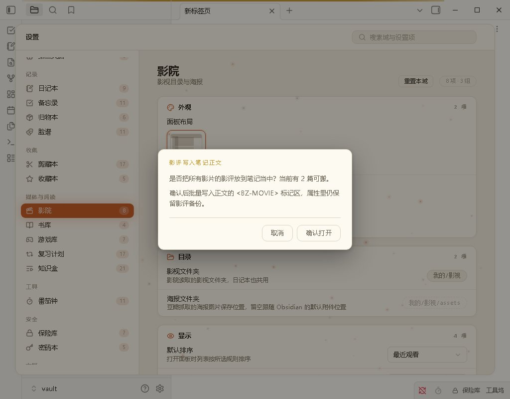

# 影评写入笔记正文 · 真机验证报告

- 日期：2026-11-21
- 分支：`feat/cinema-review-in-note`（worktree `D:/Obsidian/bz-wt-review-in-note`，从最新 master `283082e6` 分叉）
- 插件归属：**bz**（影视/影院域）
- 真机环境：独立 Obsidian 进程 + 独立库，桌面 1024×800 / 移动端 390×844@3x

## 一、改动摘要

1. 影院设置页「显示」组新增开关「影评写入笔记正文」，默认关。
2. 打开/关闭都先弹**影院风格二次确认框**，篇数实时统计；取消 / Esc / 点遮罩不写值、不翻开关。
3. 打开：批量把属性影评写进笔记正文 `<BZ-MOVIE>…</BZ-MOVIE>` 区，位置固定在 frontmatter 之后、海报之前；无影评的影片跳过（不留空块），已有标记只换内容不重复插。
4. 关闭：批量清除正文标记；正文里改过的内容先并回属性，再删标记，属性始终留备份。
5. 双向同步：界面改影评 → 同步写正文标记；笔记正文改影评 → 同步回属性（日记本回忆墙/小橘观察等读属性的消费点无需改动）。
6. 冲突按写入先后，最后落盘的那边为准。

## 二、逐项真机验证

### 1. 打开开关的二次确认

点击开关后弹出影院 `.cn-modal` 那张确认框：标题「影评写入笔记正文」，正文「是否把所有影片的影评放到笔记当中？当前有 **2 篇**可搬。」（测试素材 3 篇中甲/乙有影评、丙无，统计正确），动作钮「确认打开」+「取消」。

### 2. 取消回滚

点「取消」后：开关 `aria-checked=false`、设置值 `false`、弹窗节点归零。确认「取消不动数据」。

### 3. 确认打开 → 批量迁入

点「确认打开」后检查三篇笔记正文：

- 甲、乙：`<BZ-MOVIE>` 区存在且内容分别为 `**很好看** 值得一看` / `一般般`，位置在 frontmatter 之后、海报 embed 之前。
- 丙：无影评 → 无标记（增强 1 落实）。
- 属性 `影评` 三篇均保留（备份口径落实）。
- 开关 `true`、设置 `true`。

### 4. 正文改影评 → 属性同步

在甲的笔记正文把标记内容改为「**超好看** 正文改的」，等待后台同步后读 frontmatter：`影评 = **超好看** 正文改的`。再打开影院详情，界面显示的也是这段正文改动——说明属性与正文双向一致。

### 5. 界面改影评 → 正文同步

在影院详情点「编辑」，把影评框改成「界面改的影评」并保存：

保存后检查：属性 `影评 = 界面改的影评`，正文 `<BZ-MOVIE>` 区内容同为「界面改的影评」。双向同步闭合。

### 6. 标记位置修复（真机发现的边界问题）

真机发现：保存触发豆瓣回填海报时，`insertPosterEmbed` 会把海报 embed 插到 frontmatter 之后，把标记挤到海报下面。已将 `setReviewInContent` 改为「先摘旧块再在最前重插」，重开开关后复查甲的正文：`---` 之后第一个节点就是 `<BZ-MOVIE>`，海报在其后，符合「笔记顶部、海报上面」。

### 7. 关闭开关的二次确认与清除

点开关弹出关闭确认框：标题「关闭影评写入笔记」，正文「当前有 **2 篇**笔记在正文放了影评。关掉后是否批量清除正文里的标记、只在属性中保留影评？正文里改过的内容会先并回属性，不会丢。」，「确认关闭」为危险按钮样式。

点「确认关闭」后：开关 `false`、设置 `false`；甲、乙正文标记已清除，属性分别保留「界面改的影评」「一般般」（正文改过的内容没丢）；丙无变化。

### 8. 移动端

移动端实例无 error 日志；设置面板在移动端布局下未打开（既有行为，非本次改动引入），本次功能验证以桌面端为准。

## 三、门禁结果

- 新增测试 `tests/cinema/review-in-note.test.ts`（8 项）与 `review-in-note-settings.test.ts`（2 项）全绿；既有 `tests/cinema/settings.test.ts` 契约更新后全绿。
- `tsc --noEmit` 通过。
- D3 写契约守门通过：新增一条白名单豁免（`src/cinema/review-in-note.ts`，影视笔记 md 用户文档写，与 `cinema/douban-fetcher.ts` 同口径）。
- 完整门禁 `test-affected --since master`：**348/349 文件、4938/4939 测试通过**。唯一失败 `tests/home/river-cache.test.ts` 是基线 flaky（主仓未改动版本同样失败，断言 expected 2 got 3），与本次改动无关。

## 四、用户决策落实

- 增强采纳 **1、3、5**：跳过无影评影片 / 确认框实时统计篇数 / 重复打开不重复插标记；增强 2、4 不做。
- 问题 3「**不留**」空标记区；问题 5「**是**」，标记放在正文最开头、海报之前。
- 其余按建议：开关放设置页影院栏、属性留备份且正文为准、冲突时最后改的那边为准、取消/失败回滚与穿皮弹窗等正确性保障照做。
